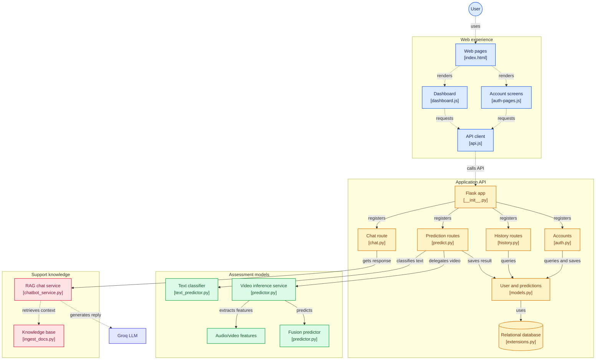

# D-Mind: Depression Detection System


**D-Mind** is an AI-powered web application for early mental health assessment. It combines text-based analysis, video/audio-based analysis, an AI chatbot and prediction history tracking in one platform, to promote mental health awareness and early intervention.

> ⚠️ **Disclaimer:** D-Mind is a screening and awareness tool built as an academic project. It is **not** a medical device and does **not** provide a clinical diagnosis. If you or someone you know is struggling, please contact a qualified mental health professional or a local crisis helpline.

---

## 📌 Table of Contents

- [Problem Statement](#-problem-statement)
- [Objectives](#-objectives)
- [Features](#-features)
- [System Workflow](#-system-workflow)
- [Datasets](#-datasets)
- [Models](#-models)
  - [Text Model (BERT)](#1-text-based-depression-detection-bert)
  - [Video Model (Gated Multimodal Fusion)](#2-video-based-depression-detection-gated-multimodal-fusion)
- [Results](#-results)
- [Tech Stack](#-tech-stack)
- [Installation & Usage](#-installation--usage)
- [Potential Use Cases](#-potential-use-cases)
- [Limitations & Ethical Considerations](#-limitations--ethical-considerations)
- [Team](#-team)

---

## ❓ Problem Statement

Early detection of depression and anxiety is difficult because many people do not recognize symptoms at an early stage. Traditional assessment methods rely on questionnaires and clinical evaluations, which are often subjective and unsuitable for continuous monitoring. There is also a lack of an integrated platform that offers intelligent analysis, real-time support and long-term mental health tracking in a single system.

## 🎯 Objectives

- Develop an AI-based platform for depression detection.
- Analyze user text using Natural Language Processing (NLP).
- Classify mental health conditions into multiple categories.
- Implement multimodal analysis using audio and visual features.
- Integrate an AI chatbot for emotional support.
- Store prediction history for long-term progress monitoring.
- Provide a secure, user-friendly web-based solution.

## ✨ Features

| Feature | Description |
|---|---|
| **Text analysis** | BERT-based classifier labels text as *Normal*, *Depression*, *Anxiety* or *Suicidal*, with a confidence score |
|  **Video/audio analysis** | Gated Multimodal Fusion model combines speech and facial features to predict *Depressed* / *Not Depressed* |
| **AI chatbot** | Emotional-support chatbot powered by the Groq API and a Meta Llama model |
| **History tracking** | Predictions are stored per user and visualized over time |
| **User accounts** | Registration and login, with user data stored in PostgreSQL |

## 🔄 System Workflow

1. The user registers and logs in.
2. The user provides input: **text**, or **video/audio**.
3. The input is processed by the matching AI module:
   - **Text:** preprocessing → tokenization → BERT classification
   - **Video:** feature extraction → multimodal fusion → prediction
4. Results are shown with a confidence score.
5. Prediction records are saved and displayed in the history view.

---

## 📊 Datasets

| Dataset | Modality | Number of Samples | Link / Source |
| :--- | :--- | :--- | :--- |
| **D-Vlog** (Depression Vlog) | Video (Audio + Visual) | **961** vlogs (from 816 speakers) | [Original Paper / Kaggle](https://www.kaggle.com/datasets/roohanis/d-vlog) |
| **Mental Health Text Classification** | Text | **49,612** samples | [Hugging Face](https://huggingface.co/datasets/ourafla/Mental-Health_Text-Classification_Dataset) |

> **Note:** The D-Vlog dataset is not hosted on Hugging Face; it is available via the original research paper or Kaggle mirrors. The text dataset is publicly downloadable from Hugging Face.

---

## 🤖 Models

### 1. Text-Based Depression Detection (BERT)

- **Model:** BERT (`bert-base-uncased`), a transformer model that understands the context of whole sentences (110M parameters, 12 layers, 12 attention heads).
- **Task:** Multi-class text classification
- **Classes:** `Normal`, `Depression`, `Anxiety`, `Suicidal`
- **Pipeline:** user text → preprocessing → BERT tokenizer → contextual analysis → classification with confidence score
- **Training:** 5 epochs, AdamW (lr=2e-5), batch size 16, weighted CrossEntropyLoss, T4 GPU (~25 mins)
- **Dataset:** Mental Health Text Classification Dataset (~49,000 samples)

### 2. Video-Based Depression Detection (Gated Multimodal Fusion)

The video model uses a **Gated Fusion** approach instead of simple feature concatenation. A learnable gate decides, for each sample, how much to trust the audio versus the visual features. If the face is poorly visible (bad lighting, face out of frame), the gate shifts weight to audio, and vice versa.

#### Input features

The model uses pre-extracted features from the **D-Vlog** dataset, which also helps with privacy because no raw audio or video is used for training.

- **Audio:** 25 low-level acoustic descriptors (eGeMAPS-style LLDs such as loudness, MFCCs and spectral flux), extracted with OpenSMILE
- **Visual:** 136-dimensional facial landmarks (68 points × x, y), extracted with Dlib
- **Metadata:** gender (1 = male, 0 = female) and normalized video duration

#### Architecture


#### Training configuration

| Parameter | Value |
|---|---|
| Framework | PyTorch |
| Optimizer | AdamW |
| Learning rate | 1e-4 |
| Weight decay | 1e-2 |
| Loss | `BCEWithLogitsLoss` (`pos_weight = 0.73`) |
| Batch size | 16 |
| Epochs | 40 |
| LR scheduler | `ReduceLROnPlateau` (patience = 5, factor = 0.5) |
| Early stopping | patience = 8 |
| Validation | 5-fold cross-validation |
| Hardware | NVIDIA T4 GPU |

#### Inference strategy

- **2-model ensemble:** the best 2 folds from 5-fold cross-validation are averaged.
- **Test-time augmentation (TTA):** Gaussian noise (σ = 0.01) is added to the inputs at prediction time.

---

## 📊 Results

| Model | Task | Result |
|---|---|---|
| **BERT** (text) | 4-class classification (Normal / Depression / Anxiety / Suicidal) | Accuracy ≈ **85%** |
| **Gated Multimodal Fusion** (video) | Binary classification (Depressed / Not Depressed) | Accuracy ≈ **78%** · Macro F1 = **0.78** |

**Video model, detailed metrics:**

| Metric | Score |
|---|---|
| Accuracy | ~78% |
| Precision (Depression class) | 89% |
| Recall (Normal class) | 88% |
| Macro F1-score | 78% |

---

## 🛠 Tech Stack

| Layer | Technologies |
|---|---|
| **Frontend** | HTML5, CSS3, JavaScript |
| **Backend** | Python, Flask |
| **Database** | SQLite (users, prediction results, history) |
| **AI / ML** | BERT (NLP), Gated Multimodal Fusion (PyTorch), Groq API, Meta Llama |
| **Feature extraction** | OpenSMILE (audio), Dlib (facial landmarks) |

---

## 🚀 Installation & Usage

> Update the commands below if your file names differ.

### Prerequisites

- Python 3.9+
- `pip` and `git`
- A [Groq API key](https://console.groq.com/) for the chatbot

### Steps

```bash
# 1. Clone the repository
git clone https://github.com/najmarazzaq761/FYP.git
cd https://github.com/najmarazzaq761/FYP

# 2. Create and activate a virtual environment
python -m venv venv
source venv/bin/activate        # Windows: venv\Scripts\activate

# 3. Install dependencies
pip install -r requirements.txt

# 4. Add your environment variables (create a .env file in the project root)
echo "GROQ_API_KEY=your_api_key_here" > .env

# 5. Run the application
python app.py
```

Then open **http://127.0.0.1:5000** in your browser.

### How to use

1. **Register** a new account and **log in**.
2. Choose an input type:
   - **Text:** type how you feel and submit it for analysis.
   - **Video/audio:** upload or record a short video of yourself speaking.
3. View the **prediction and confidence score**.
4. Chat with the **AI chatbot** for emotional support.
5. Open the **History** tab to see how your results change over time.

---

## 🌍 Potential Use Cases

- **Clinical triage support:** a preliminary score to help clinicians prioritize patients.
- **Progress tracking:** repeated check-ins during therapy to follow trends over time.
- **Telehealth and remote screening:** a first screening step for people with limited access to mental health services.
- **Personal journaling:** a private space to talk and track mood over time.
- **Campus and workplace wellness:** an opt-in tool that points people toward resources early.
- **Research:** quantifiable vocal and facial measures to complement questionnaires such as PHQ-9.

## ⚖️ Limitations & Ethical Considerations

- Predictions are probabilistic, and the video model reaches ~78% accuracy, so errors will occur. Results must never replace professional assessment.
- The video model was trained on the D-Vlog dataset, so performance may differ on other populations, languages, recording conditions and cultures.
- Mental health data is highly sensitive. Handle user data securely and obtain informed consent before any real-world deployment.
- The *Suicidal* class should always be paired with clear guidance to seek immediate human help.

---

## 👩‍💻 Team

| Name | Roll No. |
|---|---|
| Sabaina Zahid | FA22-BCS-151 |
| Zainab Azhar | FA22-BCS-158 |
| Najma | FA22-BCS-171 |


